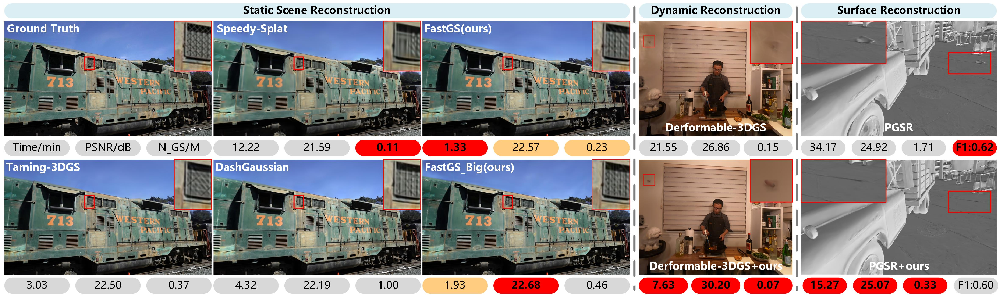
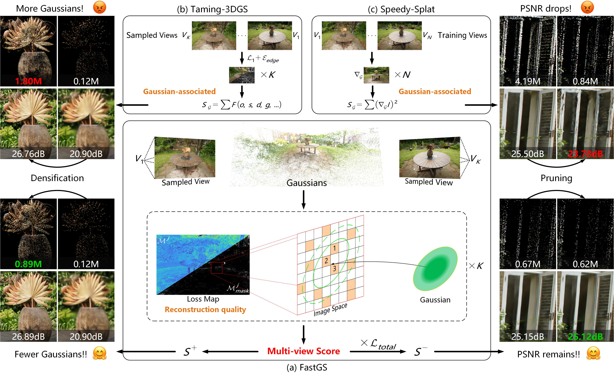
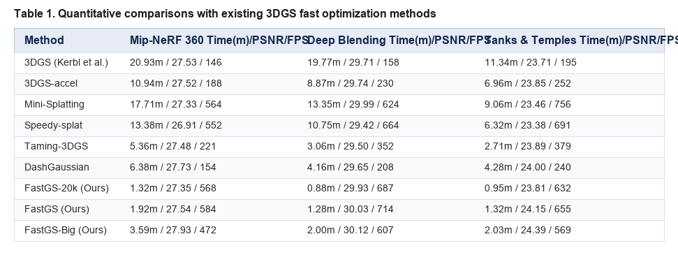
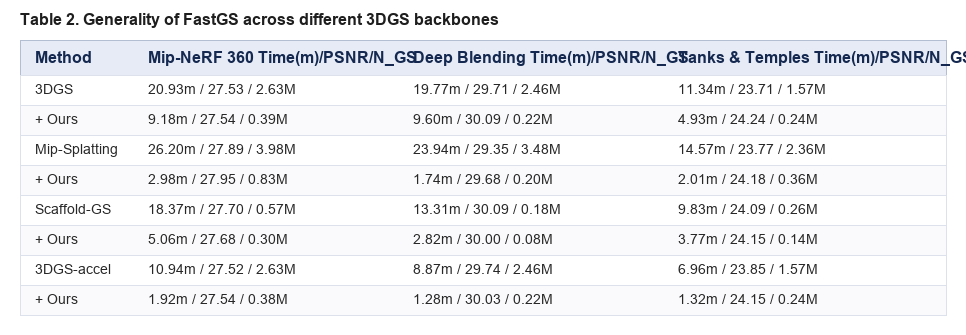
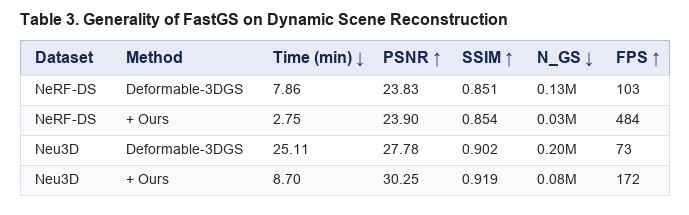
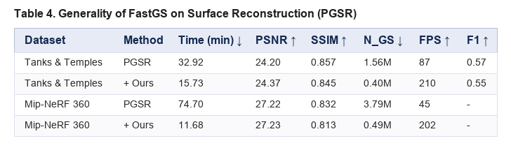
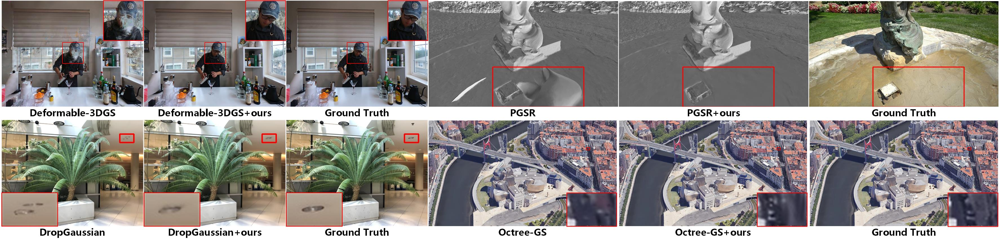
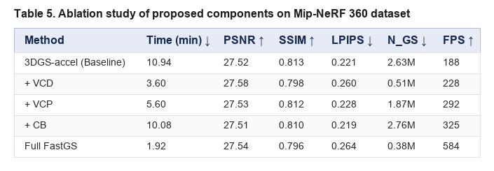

# FastGS: Training 3D Gaussian Splatting in 100 Seconds

---
Reference

본 문서에 사용된 모든 이미지와 표는 해당 논문에서 발췌하였습니다.

---

## 📌 Metadata
---
분류
- Gaussian Splatting

---

- **논문 제목**: FastGS: Training 3D Gaussian Splatting in 100 Seconds
- **저자**: Shiwei Ren, Tianci Wen, Yongchun Fang, Biao Lu
- **발표 연도**: 2025
- **공식 링크**: [arXiv](https://arxiv.org/abs/2511.04283), [Project Page](https://fastgs.github.io/)

---

### 1. 한 줄 요약
**FastGS**는 다중 시점 일관성(Multi-view Consistency) 기반의 밀집화(VCD) 및 가지치기(VCP) 전략과 Compact Box(CB) 래스터화 기법을 도입하여, 인위적인 예산(Budget) 메커니즘 없이 렌더링 품질을 유지하면서 단 100초 이내에 3D Gaussian Splatting 모델을 학습시키는 범용 가속화 프레임워크이다.

---

### 2. 핵심 아이디어
- **다중 시점 일관성 기반 밀집화 (Multi-view Consistent Densification, VCD)**:
  - 렌더링 재구성 오차(L1 Error)가 높은 영역에 위치하는 3D 가우시안의 2D 풋프린트(Footprint) 내 고오차 픽셀 수를 여러 샘플링 시점 상에서 누적 집계함.
  - 가우시안 자체 속성이 아닌 다중 시점 렌더링 품질 저하에 일관되게 기여하는 가우시안만을 정밀하게 밀집화하여 불필요한 잉여 가우시안 생성을 원천 차단함.
- **다중 시점 일관성 기반 가지치기 (Multi-view Consistent Pruning, VCP)**:
  - 전체 이미지 광학 손실(Photometric Loss)과 연동하여 다중 시점 렌더링 품질 향상에 기여하지 못하는 중복(Redundant) 가우시안의 가지치기 중요도를 평가하고 적극 제거함.
- **Compact Box (CB)**:
  - 래스터화 전처리 단계에서 마할라노비스(Mahalanobis) 거리를 기준으로 픽셀 기여도가 미비한 Gaussian–Tile 쌍을 차단하여 렌더링 및 역전파 연산 오버헤드를 대폭 가속함.
- **예산 제약 프리 (Budget-free Mechanism)**:
  - 기존 연구처럼 가우시안 개수를 강제로 제한하는 예산(Budgeting) 메커니즘 없이도 다중 시점 일관성 기반 중요도 평가만으로 최적의 가우시안 수와 구조를 유지하여 높은 범용성을 달성함.

---

### 3. 실험 결과 및 의의
- **SOTA 학습 가속화**: DashGaussian 등 기존 연구 대비 월등히 빠른 100초 이내 학습 성능을 달성함.
- **슬림한 가우시안 표현**: 수백만 개의 가우시안을 약 30만 개 수준으로 축소하여 추론 속도(FPS)와 메모리 효율성을 크게 개선함.
- **높은 이식성과 범용성**: 인위적인 예산(Budget) 제약이 없어 다양한 3DGS 백본 및 3D 과제(동적, 표면, SLAM 등)에 즉시 적용 가능함을 보임.

---

### 4. 한계 및 의견
- **장점**:
  - 기존 방식의 복잡한 예산 조절 구조에서 벗어나 다중 시점 상의 픽셀 오차 및 풋프린트 기여도라는 3D 재구성 본연의 일관성 원리를 이용해 밀집화와 가지치기를 동시에 깔끔하게 해결함.
- **한계점 및 주관적 의견**:
  - 초고속 버전(FastGS)은 미세 고주파 질감 부분에서 표현력이 약간 감소할 수 있어, 극상의 품질이 요구되는 환경에서는 100 step 간격 밀집화를 수행하는 FastGS-Big 변종 선택이 권장됨.
  - SfM 포인트 클라우드의 초기화 품질이 낮을 경우 초기에 오차 기반 VCD가 비효율적 밀집화를 유도할 가능성이 있으므로, 초기화 조건에 대한 강건성 연구가 향후 과제로 남음.

---

## 1. Introduction
- **연구 배경 및 문제의식**:
  - Neural Radiance Field (NeRF, Mildenhall et al., 2021)는 복잡한 시존 렌더링을 가능하게 했으나 수시간의 학습 시간이 소요됨.
  - 3D Gaussian Splatting (3DGS, Kerbl et al., 2023)은 명시적 3D 가우시안 원형(Primitive)과 타일 래스터라이저를 결합하여 빠른 속도를 보였으나, 실제 적용 시 장면당 10~20분 이상의 길고 비효율적인 학습 시간이 실용성을 저해함.
  - 타일 래스터라이저 연산을 개선하려는 시도(Mallick et al., 2024; Hanson et al., 2025; Feng et al., 2025; Gui et al., 2024)가 지속되었으나, 적응형 밀집 제어(ADC)의 근본적인 비효율성은 여전히 핵심 과제로 남아 있음.

> **Figure 1. FastGS 성능 개요.** FastGS는 렌더링 품질 손실 없이 3DGS 학습 시간을 획기적으로 단축하여 Mip-NeRF 360, Tanks & Temples, Deep Blending 데이터셋에서 평균 100초 이내 학습을 달성함. 나아가 동적 장면, 표면 재구성 등 다양한 과제에서도 2~7배의 학습 가속 성능을 증명함.

- **기존 가속화 기법의 2가지 흐름과 한계 분석**:
  - **(1) Densification 제어 (Budgeting 기반)**:
    - **Taming-3DGS** (Mallick et al., 2024): 예산 제약 최적화를 도입하여 가우시안 증식을 제어함.
    - **DashGaussian** (Chen et al., 2025): 적응형 가우시안 원형 예산 할당 기법으로 연속 밀집화를 유지함.
    - **한계점**: 이들은 가우시안의 다중 시점 렌더링 품질 기여도가 아닌 불투명도, 스케일, 깊이, 기울기 등 **가우시안 자체 속성 점수(Gaussian-related scores)**에 의존함. 이로 인해 특정 몇몇 시점 상의 소폭 품질 개선에만 기여하는 중복 가우시안 생성을 억제하지 못하고 여전히 수백만 개의 가우시안 오버헤드를 유지함.
  - **(2) Pruning 제어 (가지치기 기반)**:
    - **Speedy-Splat** (Hanson et al., 2025): Soft pruning 및 Hard pruning 전략을 사용함.
    - **한계점**: 학습 시점 전반에 걸친 Hessian 근사치를 사용하나, 이는 각 가우시안이 실제 다중 시점 렌더링 품질에 미치는 직접적 기여도를 평가하지 못하므로 렌더링 품질이 뚜렷하게 저하됨.
  - **기존 연구의 다중 시점 일관성(Multi-view Consistency) 활용 분류**:
    - **미이용 연구들**: kerbl et al. (2023), Kim et al. (2024), Kheradmand et al. (2024), Ye et al. (2024), Chen et al. (2025), Ali et al. (2024), Girish et al. (2024), Salman et al. (2024) 등은 다중 시점 일관성을 고려하지 않음.
    - **서브옵티멀 이용 연구들**: Zhang et al. (2024), Mallick et al. (2024), Hanson et al. (2025) 등은 다중 시점 정보를 가우시안 자체 속성이나 기울기/Hessian 근사치로만 활용하여 정밀 제어에 실패함.

> **Figure 2. Gaussian Count Over Training Iterations.** 학습 진행에 따른 가우시안 개수 변화. FastGS는 정밀한 VCD 및 VCP 덕분에 인위적 예산 제약 없이도 학습 전체 과정 동안 가장 작은 가우시안 개수(약 30만 개)만을 유지함.

- **FastGS의 핵심 인사이트 및 해결책**:
  - 전통적인 3D 재구성의 Bundle Adjustment 개념과 동일하게, 3D 공간 상의 각 가우시안 원형은 해당 3D 영역을 관찰하는 다중 시점 상에서 일관되게 재구성 품질 개선에 기여해야 함.
  - **Multi-view Consistent Densification (VCD)**: 샘플링된 시점들의 렌더링 오차 맵 상에서 2D 풋프린트 내 고오차 픽셀 수를 누적 측정하여 정밀 밀집화를 수행함.
  - **Multi-view Consistent Pruning (VCP)**: 전체 Photometric Loss와 연동하여 다중 시점 렌더링 품질 향상에 기여하지 못하는 중복 가우시안을 제거함.
  - **Budget-free**: 가우시안의 추가 및 사멸 대상을 정확히 파악하므로 예산 메커니즘이 불필요하며 다른 타스크 및 백본으로의 확장이 용이함.
- **핵심 기여 (Contributions)**:
  1. 렌더링 품질 저하 없이 100초 이내 장면 학습이 가능한 신규 범용 가속 프레임워크 FastGS 제안.
  2. 다중 시점 재구성 품질 기여도에 기반하여 가우시안 증감 생멸을 정밀 통제하는 VCD 및 VCP 전략 제안.
  3. Mip-NeRF 360, Tanks & Temples, Deep Blending 데이터셋에서의 SOTA 학습 속도 및 표현 효율성 달성.
  4. 동적 장면, 표면 재구성, 희소 시점, 대규모 재구성, SLAM 등 다양한 과제에서 2~7배 가속이라는 강력한 범용성 증명.

---

## 2. Related Work
- **Gaussian densification**:
  - 3DGS-MCMC (Kheradmand et al., 2024): 몬테카를로 샘플링 기반 가우시안 밀집화.
  - Taming-3DGS (Mallick et al., 2024), DashGaussian (Chen et al., 2025): 예산 메커니즘을 적용하여 가우시안 증식을 제어하려 시도했으나, 여전히 수백만 개의 가우시안을 유지해야 하므로 중량급 최적화 오버헤드가 발생함.
- **Gaussian Pruning**:
  - Trimming-3DGS (Ali et al., 2024), LightGaussian (Fan et al., 2024), EAGLES (Girish et al., 2024): 가우시안 속성에 기반한 중요도 점수로 덜 중요한 가우시안 사멸.
  - Mini-Splatting (Fang et al., 2024): 교차 보존 및 샘플링 기반 단순화 전략 사용.
  - PUP 3DGS (Hanson et al., 2025), Speedy-Splat (Hanson et al., 2025): 전체 학습 시점 상의 Hessian 근사치를 기반으로 대량의 가우시안을 제거했으나 렌더링 품질 저하를 초래함.
- **Other Acceleration Methods**:
  - Taming-3DGS (Mallick et al., 2024): Per-splat 병렬 역전파를 구현하여 역전파 계산 속도를 비약적으로 가속함.
  - FlashGS (Feng et al., 2025), StopThePop (Radl et al., 2024), Speedy-Splat (Hanson et al., 2025): 타일 정밀 교차 연산으로 Gaussian-Tile 쌍 감축.
  - 3DGS-LM (Höllein et al., 2024): Adam 대신 Levenberg-Marquardt 최적화 적용.
  - 3DGS² (Lan et al., 2025): 커널별 우선순위 업데이트를 통한 2차 수렴 구현.

---

## 3. Background: 3D Gaussian Splatting
- **3D 가우시안 수식 정의**:
  - 각 3D 가우시안 $\mathcal{G}_i$는 위치 평균 $\boldsymbol{\mu}_i \in \mathbb{R}^3$, 회전 $r_i \in \mathbb{R}^4$, 스케일 $s_i \in \mathbb{R}^3$, 불투명도 $\sigma_i \in [0, 1)$, 구면조화함수(SH) 색상 계수 $\mathbf{c}_i \in \mathbb{R}^{16 \times 3}$로 정의됨:
    $$\mathcal{G}_i(\mathbf{x}) = \exp \left( -\frac{1}{2} (\mathbf{x} - \boldsymbol{\mu}_i)^\top \mathbf{\Sigma}_{i_{3D}}^{-1} (\mathbf{x} - \boldsymbol{\mu}_i) \right)$$
  - 회전과 스케일에 의한 3D 공분산 행렬: $\mathbf{\Sigma}_{i_{3D}} = R_i S_i S_i^\top R_i^\top$.
- **2D 투영 및 타일 래스터화 $\alpha$-blending**:
  - 카메라 뷰 변환 $W$ 및 투영 아핀 야코비안 $J$를 통한 투영 공분산: $\mathbf{\Sigma}'_{i_{3D}} = J W \mathbf{\Sigma}_{i_{3D}} J^\top W^\top$.
  - 뷰 방향 사영을 통한 2D elliptical 가우시안 공분산 $\mathbf{\Sigma}_{i_{2D}}$ 획득 후 깊이 순 정렬 집계:
    $$C(p) = \sum_{i \in N} c_i \alpha_i \prod_{j=1}^{i-1} (1 - \sigma_j), \quad \alpha_i = \sigma_i \mathcal{G}'_i(p)$$
    $$\mathcal{G}'_i(p) = \exp \left( -\frac{1}{2} (p - \boldsymbol{\mu}_{i_{2D}})^\top \mathbf{\Sigma}_{i_{2D}}^{-1} (p - \boldsymbol{\mu}_{i_{2D}}) \right)$$

---

## 4. FastGS

### 4.1 Overview
- FastGS는 SfM 포인트 클라우드 기반 초기화 후 다중 시점 일관성에 기반한 VCD(밀집화) 및 VCP(가지치기)를 도입함.

> **Figure 3. The pipeline of FastGS.** (a) Vanilla 3DGS의 적응형 밀집 제어(ADC)를 다중 시점 일관성에 기초하여 재설계. 샘플링된 시점 상의 픽셀 L1 손실 맵을 구축하고 각 가우시안의 2D 풋프린트 내 고오차 픽셀 수를 산출하여 VCD 및 VCP를 유도함. (b) Taming-3DGS의 단순 가우시안 속성 기반 점수 방식과의 비교. (c) Speedy-Splat의 Hessian 근사 기반 점수 방식과의 비교.

- Taming-3DGS 및 Speedy-Splat과의 비교:
  - Taming-3DGS (Mallick et al., 2024): 다중 시점을 고려하지만 가우시안 관련 속성(불투명도, 스케일, 깊이, 기울기 등) 기반 점수를 계산하여 제약이 약하고 중복 가우시안이 발생함 (Figure 3 (b)).
  - Speedy-Splat (Hanson et al., 2025): Hessian 근사치를 시점 상에서 누적하지만 실제 다중 시점 렌더링 품질 기여도를 측정하지 못해 렌더링 품질 저하 초래 (Figure 3 (c)).
  - FastGS (Figure 3 (a)): 각 가우시안의 다중 시점 재구성 품질 기여도를 직접 평가하여 슬림하면서도 우수한 품질 보존.

---

### 4.2 Multi-view Consistent Densification (VCD)
- **Vanilla 3DGS 및 기존 밀집화 기법의 문제**:
  - Vanilla 3DGS는 단일 2D 이미지 공간 상의 픽셀 기울기 크기만으로 밀집화를 수행하여 수백만 개의 중복 가우시안을 야기함.
  - Taming-3DGS는 다중 시점을 고려하지만 속성 기반 점수를 사용하여 가우시안을 정밀하게 제어하지 못함.
- **VCD 세부 구현 수식 및 과정**:
  1. $K$개의 무작위 샘플링된 학습 시점 $V = \{v^j\}_{j=1}^K$와 해당 Ground-truth $G=\{g^j\}_{j=1}^K$, Rendered $R=\{r^j\}_{j=1}^K$를 준비.
  2. 각 시점 $v^j$의 픽셀 $(u,v)$에서 색상 채널별 오차 산출:
     $$e_{u,v}^j = \frac{1}{C'} \sum_{c=1}^{C'} \left| r_{u,v}^{j,c'} - g_{u,v}^{j,c'} \right|$$
  3. Min-Max 정규화($N(\cdot)$)를 통한 손실 맵 $\mathcal{M}^j \in \mathbb{R}^{W \times H}$ 구축:
     $$\hat{e}_{u,v}^j = \frac{e_{u,v}^j - \min(e_{u,v}^j)}{\max(e_{u,v}^j) - \min(e_{u,v}^j) + \varepsilon}$$
  4. 임계값 $\tau$ 적용을 통한 고오차 픽셀 영역 마스크 $\mathcal{M}_{\text{mask}}^j$ 생성:
     $$\mathcal{M}_{\text{mask}}^j = \mathbb{I}(\mathcal{M}^j > \tau)$$
  5. 3D 가우시안 $\mathcal{G}_i$의 2D 풋프린트 $\Omega_i$ 내 고오차 픽셀 수를 $K$개 시점에서 평균 집계하여 중요도 점수 $s_i^+$ 계산:
     $$s^i_d = \frac{1}{K} \sum_{j=1}^K \sum_{p}^{\Omega_i} \mathbb{I}\left( \mathcal{M}_{\text{mask}}^j(p) = 1 \right)$$
  6. $s^i_d > \tau_d$ 조건 충족 시 해당 가우시안을 밀집화(Densification) 대상으로 선택. 순전파 패스 시 풋프린트 정보로부터 직접 추출되므로 연산이 극도로 고속 처리됨.

---

### 4.3 Multi-view Consistent Pruning (VCP)
- **기존 가지치기 기법의 문제**:
  - Trimming-3DGS, LightGaussian, Mini-Splatting 등은 가우시안 중복을 정밀 제거하지 못함.
  - Speedy-Splat은 Hessian 근사치 누적으로 인해 품질 저하가 심각함.
- **VCP 세부 구현 수식 및 과정**:
  1. 각 시점 $v^j$에서의 이미지 전체 Photometric loss $E_{\text{photo}}^j$ 구함:
     $$E_{\text{photo}}^j = (1 - \lambda) L_1^j + \lambda (1 - L_{\text{SSIM}}^j)$$
  2. 오차 픽셀 수 및 Photometric loss를 수식 결합하여 가지치기 중요도 점수 $s_i^-$ 산출:
     $$s^i_p = \mathcal{N}\left( \sum_{j=1}^K \left( \sum_{p}^{\Omega_i} \mathbb{I}\left( \mathcal{M}_{\text{mask}}^j(p) = 1 \right) \right) \cdot E_{\text{photo}}^j \right)$$
  3. $s^i_p > \tau_p$ 초과 시 가우시안을 가지치기(Pruning)하여 다중 시점 렌더링 품질에 불필요한 가우시안을 정밀 사멸함.

---

### 4.4 Compact Box (CB)
- Vanilla 3DGS는 $3\sigma$ 규칙으로 2D 타원 영역을 구하여 타일 래스터화 시 과도한 Gaussian–Tile 쌍을 형성함.
- Speedy-Splat의 precise tile intersect 이후에도 여전히 미비한 픽셀 기여도를 가진 가우시안이 존재함을 착안함.
- Compact Box는 중심으로부터의 마할라노비스(Mahalanobis) 거리를 기준으로 픽셀 기여도가 극히 적은 Gaussian-Tile 쌍을 감축하여 래스터화 계산 및 역전파 속도를 크게 개선함.

---

### 4.5 Optimization
- Vanilla 3DGS와 동일한 L1 및 SSIM 손실 결합 최적화:
  $$\mathcal{L} = (1 - \lambda) \mathcal{L}_1 + \lambda (1 - \mathcal{L}_{\text{SSIM}})$$

---

## 5 Experiments

### 5.1 Experimental Setup
- **데이터셋**: Mip-NeRF 360, Deep Blending, Tanks & Temples 및 동적 장면(D-NeRF, NeRF-DS, Neu3D), 표면 재구성(PGSR), 희소 시점(LLFF), 대규모 장면(BungeeNeRF), SLAM (Replica).
- **지표**: PSNR, SSIM, LPIPS (품질), 학습 시간(분), 가우시안 수 ($N_{GS}$), 추론 속도 (FPS).
- **실험 세팅 및 환경**:
  - Adam optimizer (30K iterations). $K=10$, $\lambda=0.2$.
  - 기본 FastGS: 500 iteration마다 densification (15k까지).
  - FastGS-Big: 최고 품질 요구 환경을 위한 변종으로 100 iteration마다 densification.
  - 모든 비교 실험은 동일한 NVIDIA RTX 4090 GPU 환경에서 공식 코드로 수행됨.
  - 베이스라인: Taming-3DGS의 per-splat parallel backpropagation을 통합한 `3DGS-accel`.

---

### 5.2 Comparison with Fast Optimization Methods

> **Table 1. Quantitative comparisons with existing 3DGS fast optimization methods.** Mip-NeRF 360, Deep Blending, Tanks & Temples 데이터셋에서의 정량적 비교.

- **정량적 분석**:
  - FastGS는 평균 **100초 이내** (최단 77초)에 학습을 완료하며 현존 SOTA 모델 중 가장 빠른 성능을 보여줌.
  - **DashGaussian 대비**: Mip-NeRF 360 기준 FastGS-Big 변종은 PSNR을 0.2dB 이상 향상시키면서 학습 시간을 43.7% 단축하고 가우시안 개수를 절반 이하로 감소시킴.
  - **Speedy-Splat 대비**: Speedy-Splat은 가지치기 시 렌더링 품질이 크게 저하되었으나, FastGS는 우수한 PSNR/SSIM을 원본 수준으로 철저히 유지함.

> **Figure 4. Qualitative results of Table 1.** Mip-NeRF 360 데이터셋의 "kitchen", "stump", Deep Blending의 "playroom", Tanks & Temples의 "truck" 시퀀스 정성적 비교. FastGS 및 FastGS-Big은 복잡한 세부 기하 구조를 정밀 복원함.

---

### 5.3 Generality of FastGS

> **Table 2. Generality of FastGS across different 3DGS backbones.** 다양한 가우시안 백본(3DGS, Mip-Splatting, Scaffold-GS, 3DGS-accel)에서의 가속 성능.

> **Table 3. Quantitative results of dynamic scene reconstruction.** Deformable-3DGS 백본 기반 동적 장면 재구성 정량 비교.

> **Table 4. Quantitative results of surface reconstruction.** PGSR 백본 기반 표면 재구성 정량 비교.

> **Figure 5. Visualization results on four representative tasks.** Neu3D (동적 장면), Tanks and Temples (표면 재구성), LLFF (희소 시점), BungeeNeRF (대규모 장면)에서의 대표 렌더링 정성 결과.

- **백본 및 Downstream Task 확장성 검증**:
  - Mip-Splatting, Scaffold-GS 등 대표적인 가우시안 백본에 FastGS를 결합 시 품질 저하 없이 **2~14배의 학습 속도 향상**과 평균 **77.46%의 가우시안 개수 감축**을 달성함.
  - 동적 장면, 표면 재구성, 희소 시점, 대규모 재구성 등 다양한 3D 과제에서도 2~7배의 학습 가속을 보임.

---

### 5.4 Ablation Study

> **Table 5. Ablation studies over the proposed methods of FastGS.** Mip-NeRF 360 데이터셋 상에서 각 제안 모듈(VCD, VCP, CB)의 소거 연구 결과.

- **각 구성요소의 효과**:
  - **VCD 단독 추가**: 학습 시간을 약 3배 가속하고 가우시안 개수를 80% 감소시킴.
  - **VCP 추가**: 학습 시간을 48.8% 추가 단축하고 가우시안 개수를 28.9% 추가 감소시킴.
  - **CB 추가**: 렌더링 품질 저하 없이 학습 시간을 7.8% 추가 단축함.

---

### 5.5 Discussions and Limitations
- **추가 가속을 위한 한계 및 개선 방향**:
  - (1) 여전히 30K iteration의 최적화 반복이 필요하므로, 적은 iteration으로 빠르게 수렴하는 2차/대안 최적화 스케줄러 개발이 병목을 해소할 수 있음.
  - (2) COLMAP 기반 초기 포인트 클라우드에 의존하므로, 피드포워드(Feed-forward) NVS 모델의 이니셜라이제이션 및 파인튜닝과 결합 시 학습 시간을 더욱 단축시킬 수 있음.

---

## 6 Conclusion
- FastGS는 다중 시점 일관성을 활용한 VCD 및 VCP 전략을 도입하여 불필요한 가우시안 생성을 억제하고 100초 이내에 3DGS 학습을 완료하는 간결하고 강력한 가속 프레임워크이다.
- Mip-NeRF 360, Tanks & Temples, Deep Blending 등에서 SOTA 학습 속도를 달성하였으며, 다양한 가우시안 백본 및 Downstream 3D 재구성 과제 전반에 걸쳐 강력한 범용성을 입증하였다.

---
